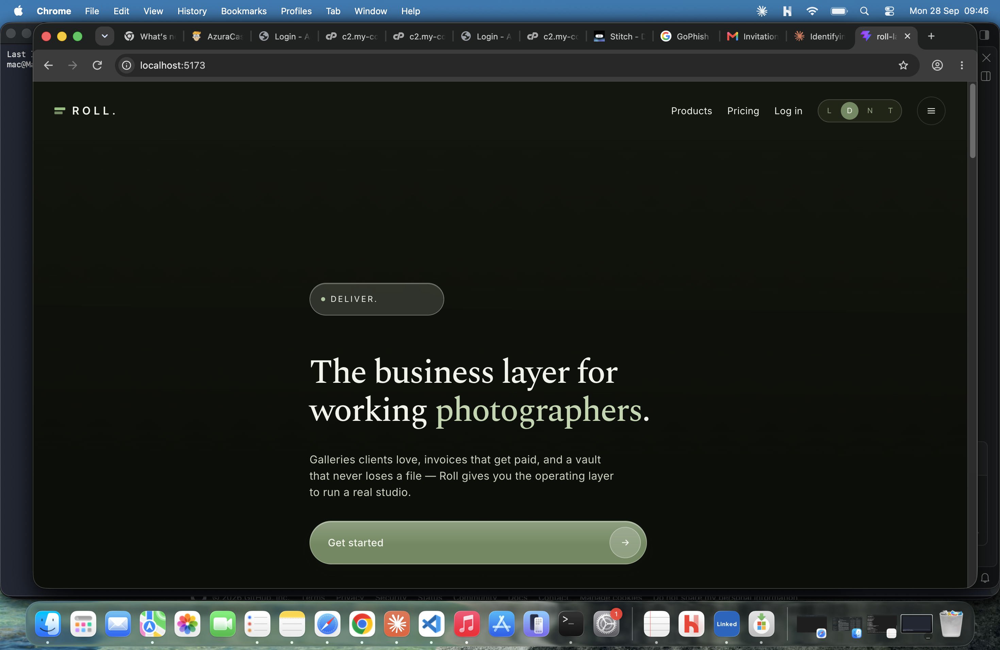

# Roll.

A landing page for **Roll**, a fictional all-in-one platform for photographers: client galleries, invoicing, and file storage in one subscription.

Built with React and Vite as a front-end design and interaction exercise.



## Features

- **Rotating hero** with crossfading images that follow the cursor (parallax), and a slot-machine text reel cycling *Shoot. Deliver. Get paid.*
- **Four themes**: light, dark, neutral, and a transparent "glass" mode. The choice is saved in `localStorage`.
- **Liquid-glass UI**: frosted, blurred panels with soft highlights across cards, mockups, and pricing.
- **Scroll reveals** that replay every time a section comes back into view, in either scroll direction.
- **Product cards** that scroll to their matching app mockup (galleries, invoices, file vault).
- **Pricing list** with a Monthly / Annual toggle and selectable plans.
- **Auto-advancing testimonials** carousel that can also be swiped sideways.
- **Accordion footer** and diagonal-stripe section dividers.
- Respects `prefers-reduced-motion`.

## Tech

- React
- Vite
- Plain CSS (injected from the component, no CSS framework)
- Google Fonts: Spectral and Inter

The entire page is one component: `src/RollLanding.jsx`.

## Getting started

```bash
git clone https://github.com/YOUR-USERNAME/roll-landing.git
cd roll-landing
npm install
npm run dev
```

Then open the local URL Vite prints (usually `http://localhost:5173`).

To create a production build:

```bash
npm run build
npm run preview
```

## Fonts

Add this to the `<head>` of `index.html` if it isn't there already:

```html
<link href="https://fonts.googleapis.com/css2?family=Spectral:wght@500;600&family=Inter:wght@400;500;600&display=swap" rel="stylesheet">
```

## Images

The hero and gallery images are generated inline SVG scenes, so the page works offline with no external requests. To use real photos, replace the `HERO_BACKDROPS` and `GALLERY_PHOTOS` arrays in `src/RollLanding.jsx` with image URLs.

## Notes

"Roll", its product names, testimonials, and pricing are made up for this project. The layout is an original design and does not use assets from any existing product.

## Author

Built by [THE WEB GUY](https://github.com/d-webguy).